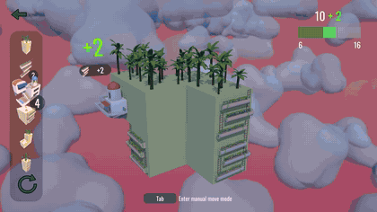
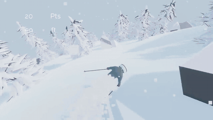

## Hi there 👋

I'm Charlie, a student at the University of Chicago interested in ML and game development. Previously I developed and published both of these games to Steam:

<table>
  <tr>
    <td align="center" width="50%">
      
       
      <a href="https://store.steampowered.com/app/4034080/Floating_Frontiers/"><b>Floating Frontiers</b></a> · 2026
       
      A minimalist city builder about growing an infinite floating town.
    </td>
    <td align="center" width="50%">
      
       
      <a href="https://store.steampowered.com/app/3218090/Off_Trail/"><b>Off Trail</b></a> · 2024
       
      A procedurally generated, infinite downhill skiing game.
    </td>
  </tr>
</table>

### Now
- ML Engineer at Thrixel: The AI 3D Model Generator for Your Coding Agent
- Studying CS/Math @ UChicago
### Current Interests
- 3D deep learning
- Agentic game and asset creation
- Sim RL for robotics
